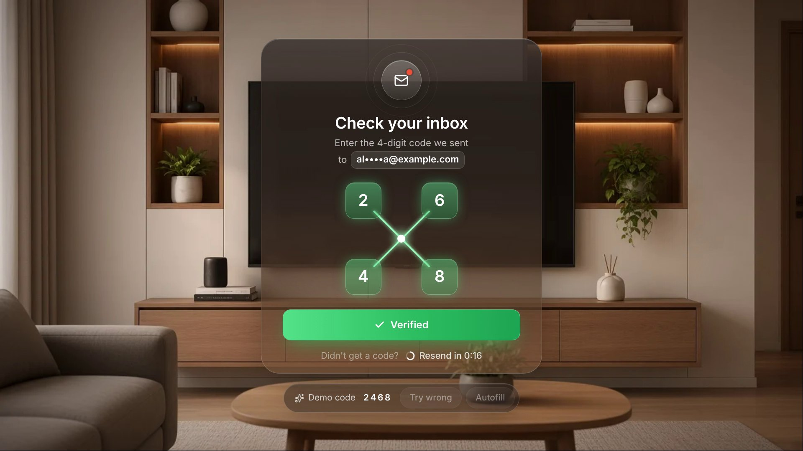
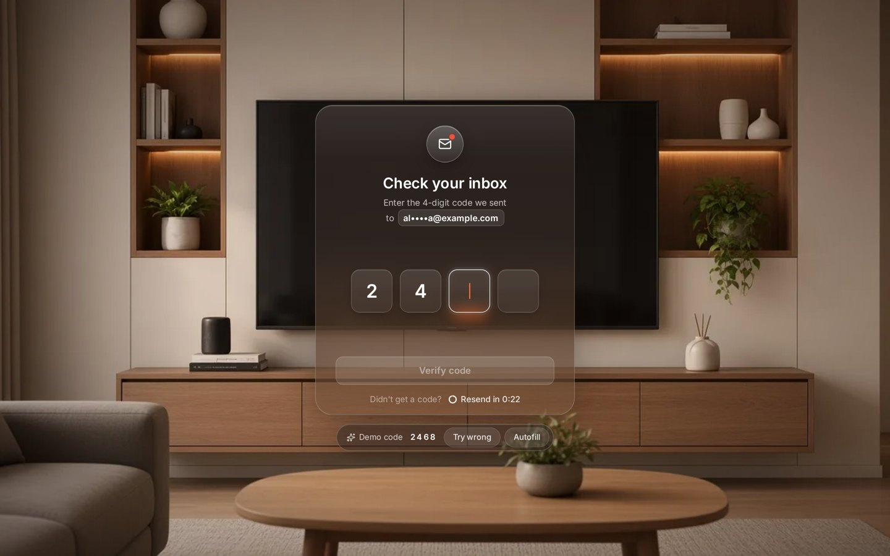
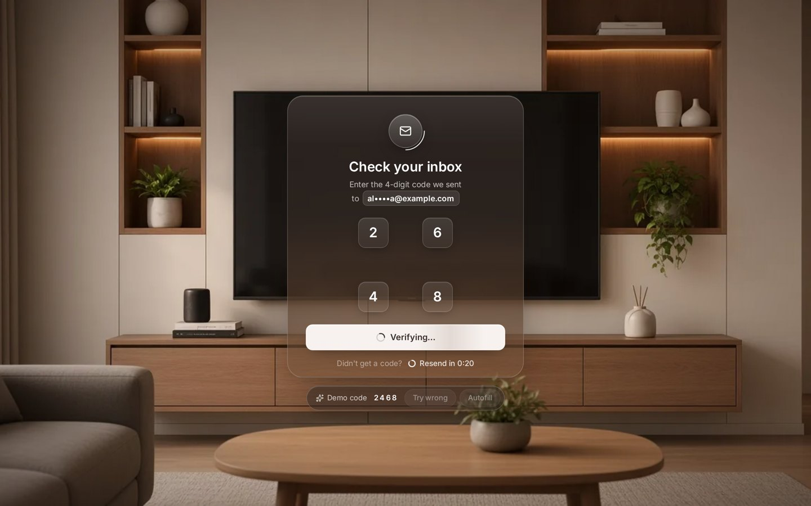
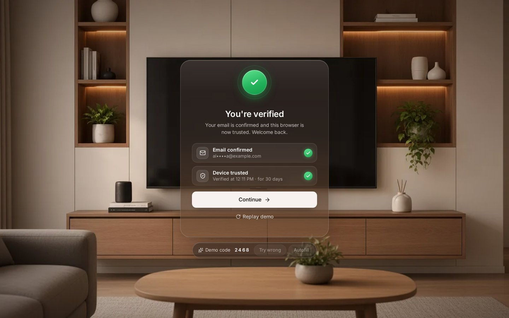
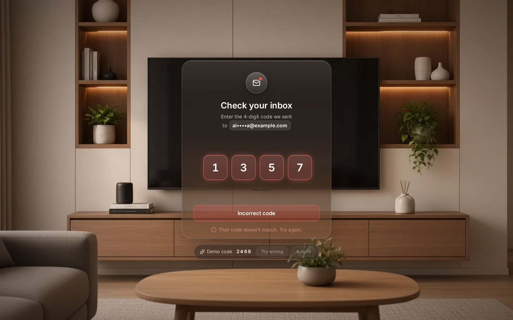
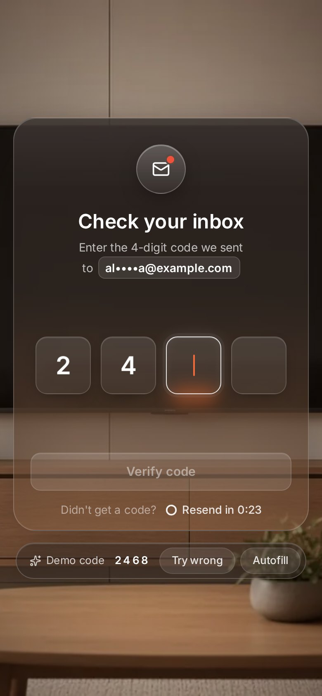
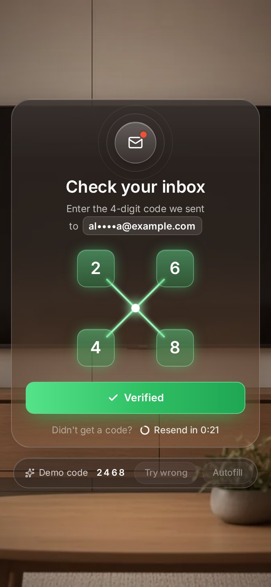
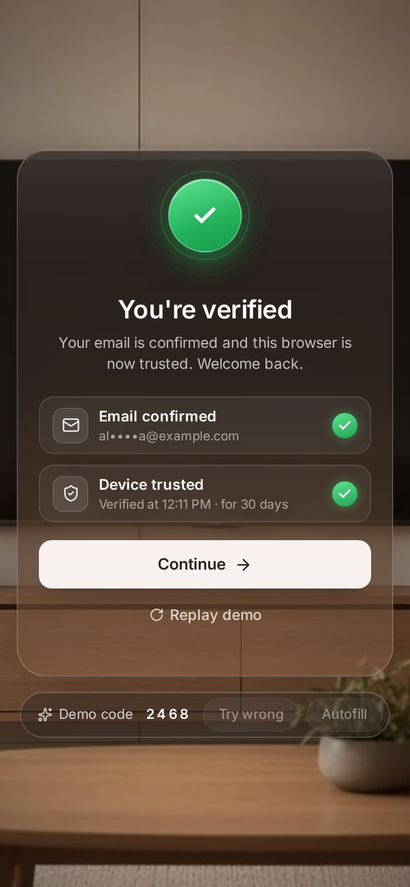
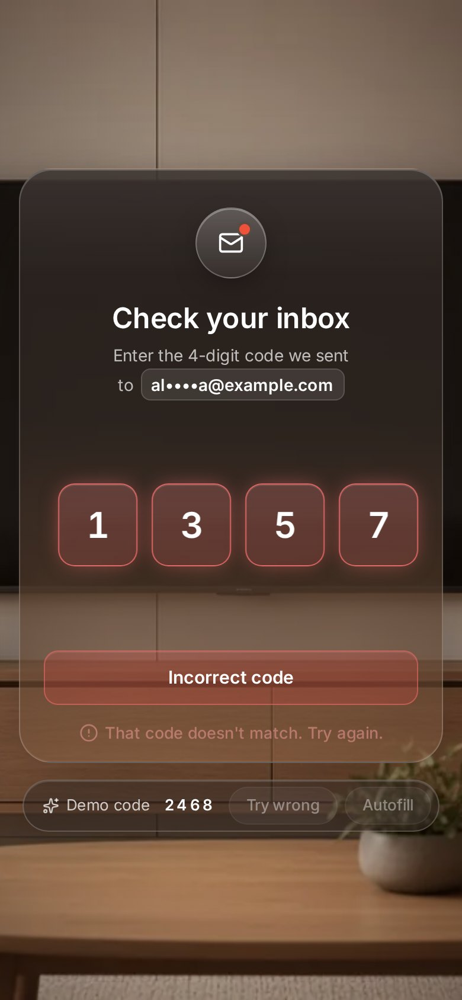

# Glassy OTP — vérification par code à 4 chiffres

Écran de vérification d'e-mail par code OTP en **verre fumé (glassmorphism)**, posé sur une photo d'intérieur chaleureuse.
Saisie animée, réorganisation des cases en 2×2, lignes lumineuses qui se connectent, fusion en une coche verte, puis écran « You're verified ».

**🔗 Démo en ligne : https://otp-verification-glassy.vercel.app**



| Saisie | Vérification | Code validé |
|---|---|---|
|  |  |  |

| Écran final | Mauvais code |
|---|---|
|  |  |

### Mobile (390 px)

| Saisie | Connexion | Vérifié | Erreur |
|---|---|---|---|
|  |  |  |  |

## Fonctionnalités

- Code à **4 chiffres** : avance automatique, retour arrière, flèches ← →, Entrée, **collage** du code entier et autocomplétion SMS/e-mail (`autocomplete="one-time-code"`).
- Anneau de focus qui **glisse** d'une case à l'autre, curseur orange qui clignote et halo sous la case active.
- Envoi automatique quand le code est complet : bouton « Verifying… », arc qui tourne autour de l'icône.
- Les cases **s'envolent en 2×2**, des **lignes vertes lumineuses** relient chaque case au centre, puis tout **fusionne** en une coche.
- Écran « You're verified » : anneaux qui pulsent, lignes « Email confirmed » et « Device trusted » (heure réelle), bouton Continue, « Replay demo ».
- Mauvais code : cases rouges, secousse, message d'erreur, remise à zéro automatique.
- Compte à rebours « Resend in 0:25 » avec anneau de progression, puis « Resend code ».
- Barre de démo : code **2468**, boutons « Try wrong » et « Autofill ».
- Responsive (mobile 390 px → grand écran) et respect de `prefers-reduced-motion`.

## Stack

- [React 19](https://react.dev) + TypeScript
- [Vite](https://vite.dev)
- [Tailwind CSS 4](https://tailwindcss.com)
- [Motion](https://motion.dev) (animations : layout, spring, pathLength)
- [lucide-react](https://lucide.dev) (icônes) et Inter (police)
- Hébergement : [Vercel](https://vercel.com)

## Lancer le projet

```bash
git clone https://github.com/Donchaminade/otp-verification-glassy.git
cd otp-verification-glassy
npm install
npm run dev      # http://localhost:5173
npm run build    # build de production dans dist/
```

Le code de démo est `2468` (n'importe quel autre code déclenche l'état d'erreur). Tout est dans `src/App.tsx`.

## Crédits

Design inspiré du reel « Glassy OTP V15 » de [@code.xr](https://www.instagram.com/code.xr/). Recréé from scratch en React, Tailwind et Motion. La photo de fond est une image générée pour le projet.

## ⭐ Star & Fork

Si ce projet t'est utile ou t'inspire, **laisse une ⭐ Star** et **fais un Fork** pour l'adapter à ton app.
Les retours et les PR sont les bienvenus !

---

Licence [MIT](LICENSE) — © 2026 Donchaminade
